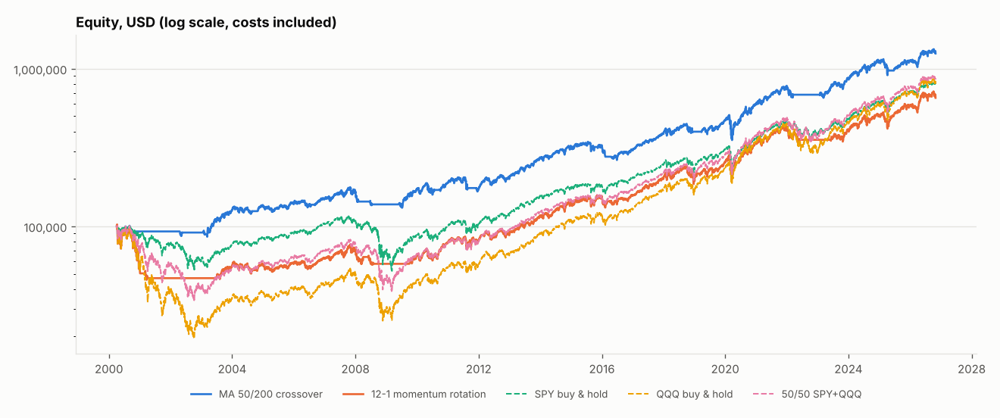
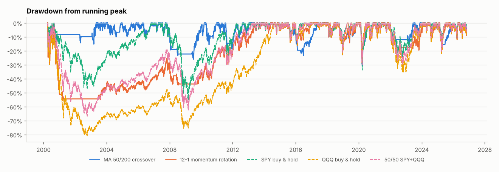

# spy_qqq_study: SPY/QQQ historical backtest

Generated 2026-11-10T09:17:19Z by `usquant study` (usquant 0.1.0, git `9ba20b94152f4e913c2ef2df03f24bf5fe63a4d4`).
Research output only. No live or paper orders are placed by this code.

**Evaluation window:** 2000-04-03 to 2026-10-30 (26.5 years, 6,685 trading days). Indicator warm-up data from 1999-03-10. Starting capital USD 100,000.

## Headline results

Costs included (see *Transaction costs*). Sharpe (rf=0) uses raw daily returns; Sharpe (T-bill) uses daily returns in excess of the 13-week T-bill (average 1.88%/yr over the window).

| | type | CAGR | total return | volatility | Sharpe (rf=0) | Sharpe (T-bill) | Sortino | max drawdown | longest underwater (days) | round trips | fills (orders) | avg exposure | costs paid (USD) |
|---|---|---:|---:|---:|---:|---:|---:|---:|---:|---:|---:|---:|---:|
| MA 50/200 crossover | strategy | 9.99% | 1149% | 15.83% | 0.68 | 0.56 | 0.96 | -30.69% | 767 | 29 | 94 | 78% | 4,209 |
| 12-1 momentum rotation | strategy | 7.33% | 553% | 19.44% | 0.46 | 0.37 | 0.65 | -55.50% | 3,295 | 40 | 81 | 81% | 3,900 |
| SPY buy & hold | benchmark | 8.13% | 694% | 19.13% | 0.50 | 0.41 | 0.71 | -55.17% | 1,543 | 0 | 1 | 100% | 25 |
| QQQ buy & hold | benchmark | 8.11% | 691% | 26.28% | 0.43 | 0.36 | 0.61 | -81.18% | 3,611 | 0 | 1 | 100% | 26 |
| 50/50 SPY+QQQ | benchmark | 8.42% | 754% | 21.87% | 0.48 | 0.39 | 0.68 | -66.79% | 3,262 | 0 | 30 | 100% | 100 |

*Round trips* = closed trades (flat -> position -> flat) per symbol; *fills* = individual executed orders, including rebalancing adds/trims and any position still open at the end. Final equity: MA 50/200 crossover USD 1,249,175; 12-1 momentum rotation USD 653,373; SPY buy & hold USD 794,293; QQQ buy & hold USD 791,314; 50/50 SPY+QQQ USD 854,216.





## Sub-periods

Metrics of the same runs, measured inside each window (positions carried in from the previous window).

| period | MA 50/200 crossover | 12-1 momentum rotation | SPY buy & hold | QQQ buy & hold | 50/50 SPY+QQQ |
|---|---:|---:|---:|---:|---:|
| 2000-04 to 2009-12 CAGR | 5.67% | -4.32% | -1.40% | -7.79% | -4.16% |
| 2000-04 to 2009-12 Sharpe (rf=0) | 0.45 | -0.11 | 0.05 | -0.07 | -0.03 |
| 2000-04 to 2009-12 max DD | -26.03% | -55.50% | -55.17% | -81.18% | -66.79% |
| 2000-04 to 2009-12 fills | 40 | 29 | 1 | 1 | 18 |
| 2010 to 2019 CAGR | 10.48% | 14.45% | 13.27% | 17.70% | 15.56% |
| 2010 to 2019 Sharpe (rf=0) | 0.77 | 0.89 | 0.92 | 1.03 | 1.00 |
| 2010 to 2019 max DD | -23.37% | -22.79% | -19.35% | -22.80% | -21.08% |
| 2010 to 2019 fills | 36 | 26 | 0 | 0 | 4 |
| 2020 to 2026-10 CAGR | 15.23% | 14.60% | 14.79% | 19.28% | 17.28% |
| 2020 to 2026-10 Sharpe (rf=0) | 0.83 | 0.75 | 0.79 | 0.84 | 0.84 |
| 2020 to 2026-10 max DD | -30.69% | -28.54% | -33.71% | -35.12% | -30.76% |
| 2020 to 2026-10 fills | 18 | 26 | 0 | 0 | 8 |

## Cost and execution sensitivity

Each row re-runs the full window with only the stated change; the default row matches the headline table.

| scenario | MA 50/200 crossover CAGR / Sharpe | 12-1 momentum rotation CAGR / Sharpe | SPY buy & hold CAGR / Sharpe | QQQ buy & hold CAGR / Sharpe | 50/50 SPY+QQQ CAGR / Sharpe |
|---|---:|---:|---:|---:|---:|
| frictionless (no commission, 0 bps) | 10.05% / 0.68 | 7.42% / 0.47 | 8.13% / 0.50 | 8.11% / 0.43 | 8.42% / 0.48 |
| default (IBKR Fixed + 2 bps) | 9.99% / 0.68 | 7.33% / 0.46 | 8.13% / 0.50 | 8.11% / 0.43 | 8.42% / 0.48 |
| 10 bps slippage | 9.79% / 0.67 | 7.07% / 0.45 | 8.12% / 0.50 | 8.11% / 0.43 | 8.42% / 0.48 |
| 25 bps slippage | 9.41% / 0.65 | 6.58% / 0.43 | 8.11% / 0.50 | 8.10% / 0.43 | 8.40% / 0.48 |
| fill at next close instead of next open | 10.05% / 0.68 | 8.18% / 0.50 | 8.17% / 0.51 | 8.18% / 0.43 | 8.48% / 0.48 |

## Data provenance

| symbol | source | vendor | price basis | first bar | last bar | rows | retrieved (UTC) | data checksum | input file SHA-256 (first 16) |
|---|---|---|---|---|---|---:|---|---|---|
| SPY | yahoo | Yahoo Finance (query1/query2.finance.yahoo.com) via yfinance 1.8.0 | split_adjusted_ohlc_with_total_return_adj_close | 1999-03-10 | 2026-10-30 | 6,955 | 2026-11-10T08:31:23Z | `57e1be96812c81af` | `bf74ffe799578f81` |
| QQQ | yahoo | Yahoo Finance (query1/query2.finance.yahoo.com) via yfinance 1.8.0 | split_adjusted_ohlc_with_total_return_adj_close | 1999-03-10 | 2026-10-30 | 6,955 | 2026-11-10T08:31:24Z | `f1c50600ac1624f8` | `a00f630db3fd8f33` |
| ^IRX (risk-free) | yahoo | Yahoo Finance via yfinance (CBOE 13-week T-bill index) | annualized_discount_yield_percent | 1999-03-10 | 2026-10-30 | 6,947 | 2026-11-10T08:31:24Z | | `0aeade617417a3c7` |

Notes recorded with the data:

* SPY: served from cache data/cache/yahoo/SPY.csv
* SPY: close/open/high/low are split-adjusted, not dividend-adjusted
* SPY: adj_close is split- and dividend-adjusted (Yahoo methodology, CRSP-style multiplier)
* SPY: Yahoo revises adj_close history whenever a new distribution is paid
* SPY: unofficial endpoint; no SLA; terms of use restrict redistribution of the raw data
* QQQ: served from cache data/cache/yahoo/QQQ.csv
* QQQ: close/open/high/low are split-adjusted, not dividend-adjusted
* QQQ: adj_close is split- and dividend-adjusted (Yahoo methodology, CRSP-style multiplier)
* QQQ: Yahoo revises adj_close history whenever a new distribution is paid
* QQQ: unofficial endpoint; no SLA; terms of use restrict redistribution of the raw data

*Data checksum* is a SHA-256 prefix of the validated frame the backtest used (`usquant.data.frame_checksum`). *Input file SHA-256* identifies the exact cache or CSV file that frame was read from. Downloads are always re-read from the cache file before use, so a run served from that file reproduces the checksum and every number exactly. A fresh Yahoo download does **not**: Yahoo's adjusted closes vary by about 1e-6 between requests, which changes the checksum and moves metrics by a few millionths (see *Reproduce*).

### Data-quality checks

| symbol | gaps > 5 days | open/close outside high-low | zero-volume bars | moves > 15% | stale bars | dividend events | price-only CAGR | close+dividends CAGR | vendor adj-close CAGR | adj vs reconstruction |
|---|---|---:|---:|---|---:|---:|---:|---:|---:|---:|
| SPY | 2001-09-10->2001-09-17 | 0 | 0 | none | 0 | 112 | 6.61% | 8.49% | 8.48% | -0.0030%/yr |
| QQQ | 2001-09-10->2001-09-17 | 0 | 0 | 2001-01-03 (+16.8%) | 0 | 90 | 9.90% | 10.59% | 10.59% | -0.0000%/yr |

The dividend check rebuilds a total-return series from the unadjusted close and the cash distributions (`(close_t + div_t) / close_{t-1}`) and compares it with the vendor's adjusted close. A gap near zero confirms the adjusted series contains every distribution. Data cover 1999-03-10 to 2026-10-30, so these CAGRs include the warm-up period.

## Adjusted prices

* Backtest prices are back-adjusted: every OHLC column is multiplied by `adj_close / close`. Returns therefore include dividends reinvested on the ex-date and splits (QQQ 2:1 on 2000-03-20) cause no jumps.
* Buy-and-hold benchmarks use the same adjusted prices, so they are total-return benchmarks.
* Adjusted historical prices are not the prices that printed. Per-share commissions and integer share counts are computed on adjusted prices; for early years this slightly misstates share counts (immaterial here).
* Dividend withholding tax, the ex-date to pay-date cash lag and taxes in general are ignored.

## Transaction costs

* Commission: USD 0.005/share, min USD 1/order, max 1% of trade value (approximates the IBKR US *Fixed* tier; exchange, clearing and regulatory fees are excluded).
* Slippage: 2 bps adverse on every fill (buys pay more, sells receive less), independent of order size or volatility.
* Orders under USD 100 are skipped; positions are re-balanced when a weight drifts more than 5 percentage points from target.
* Buy-and-hold benchmarks pay the same costs (on their single entry order, or on drift re-balances for the 50/50 mix).

## Execution model and limitations

* Signals use data up to the close of day *t*; orders fill at the **open** of day *t+1*. The opening print is assumed fully fillable at that price (plus slippage) for the whole order.
* No intraday data, no bid/ask quotes, no partial fills, no market impact model, no order queueing, no halts or circuit-breaker days beyond what the daily bars show.
* Integer shares, long only, no leverage, no shorting. Sells execute before buys; buys are scaled down so cash never goes negative.
* **Uninvested cash earns 0%.** This penalises strategies that spend time in cash (the T-bill rate averaged 1.88%/yr over the window); Sharpe (T-bill) still subtracts the T-bill rate from every day's return.
* Free Yahoo data is unofficial (no SLA, revised retroactively). Results should be re-checked against a licensed source (e.g. CRSP, a broker's historical bars) before any decision is made.
* Strategy parameters are textbook defaults chosen before this run, not optimised; still, two strategies on two highly correlated ETFs over one history is a small sample. Past performance does not predict future results.
* The evaluation start date matters: starting near the March 2000 Nasdaq peak heavily penalises QQQ buy-and-hold. See *Sub-periods*.

## Reproduce

```bash
pip install -e ".[yahoo,dev]"
```

```bash
usquant study --config configs/study_spy_qqq.yaml
```

To check a committed run, re-run it and compare against its `summary.json`:

```bash
usquant reproduce --summary docs/results/spy_qqq_study/summary.json
```

* **Exact reproduction** needs input files whose SHA-256 matches the provenance table. The raw files are not committed because Yahoo's terms restrict redistribution. With matching files every integer must match exactly and every float must agree within a relative tolerance of 1e-9; the exit code is 0.
* **Re-downloaded data** (`--refresh`, or a cache with different hashes) cannot match the checksums. The command reports that the inputs differ and compares the numbers with a tolerance of 1e-4. On 2026-11-10 the largest observed drift was 3.3e-6.

Without network access, put vendor CSVs in `data/csv/` (see the README, *CSV import*) and the `auto` provider falls back to them; the provenance table then shows `csv` as the source.
